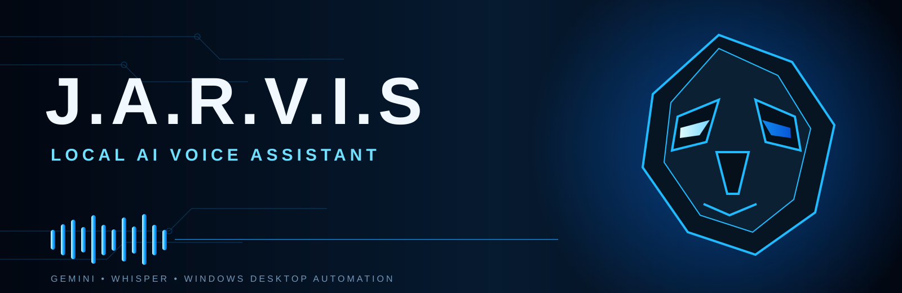

# J.A.R.V.I.S — Local AI Voice Assistant

<p align="center">
  
</p>

<p align="center">
  <strong>A Windows desktop voice assistant powered by Google Gemini and local speech recognition.</strong>
</p>

<p align="center">
  
  
  
  
  
</p>

JARVIS is a personal Windows assistant that combines a graphical desktop interface, wake-word voice interaction, Gemini-powered responses, local speech-to-text, music controls, browser automation, and selected desktop actions.

> **Project note:** This is an actively developed personal project. Features depend on your Windows configuration, installed applications, microphone, API access, and optional packages. It is not an unrestricted autonomous computer agent.

## Features

- **Voice interaction:** Detects the “Hey Jarvis” wake phrase and supports follow-up conversation mode with a 30-second inactivity timeout.
- **AI responses:** Uses the Google Gemini API (configured by default for `gemini-3.1-flash-lite`).
- **Local speech recognition:** Uses Faster-Whisper with the `base` model on CPU.
- **Desktop interface:** PySide6-based JARVIS window with listening, thinking, speaking and standby states.
- **Speech output:** Uses the Windows System.Speech synthesizer; speech can be interrupted with the configured keyboard shortcut.
- **Music:** Searches the local music library and provides playback controls; can search and open YouTube results for online music.
- **Browser tasks:** Uses Playwright with an installed Opera browser for supported browser interactions.
- **Desktop utilities:** Supports selected app launching, website opening, volume and brightness controls, screenshots, typing, keyboard shortcuts, and mouse actions.
- **Safety checks:** Sensitive actions such as sending, publishing, purchasing, booking, or deleting should require confirmation. The assistant does not execute arbitrary shell commands generated by Gemini.

## Screenshots

Screenshots of the actual running application have not yet been added. See [docs/screenshots](docs/screenshots/README.md) for the recommended captures. Please use genuine screenshots and hide personal information before publishing.

## Tech stack

| Component | Technology |
|---|---|
| Language | Python |
| AI responses | Google Gemini via `google-genai` |
| Speech recognition | Faster-Whisper |
| Audio capture | SoundDevice + NumPy |
| Desktop UI | PySide6 |
| Speech synthesis | Windows System.Speech |
| Browser automation | Playwright + Opera |
| Desktop input | Keyboard / PyAutoGUI |

## Requirements

- Windows 10/11 (developed on Windows 11)
- Python 3.13 (the current development environment; another supported Python version may also work)
- A working microphone and speakers/headset
- An internet connection for Gemini and online search features
- A Google Gemini API key
- Opera browser for the persistent Opera automation profile and browser tasks
- Optional desktop utilities may require the relevant Windows hardware or application

## Installation

### 1. Clone the repository

```powershell
git clone https://github.com/dev-vishnim/Jarvis-AI-Assistant.git
cd Jarvis-AI-Assistant
```

### 2. Create a virtual environment (recommended)

```powershell
py -3.13 -m venv .venv
.\.venv\Scripts\Activate.ps1
```

If PowerShell blocks activation, you can use the environment's Python directly:

```powershell
.\.venv\Scripts\python.exe -m pip install --upgrade pip
`.\.venv\Scripts\python.exe -m pip install -r requirements.txt
```

Otherwise, after activating the environment:

```powershell
python -m pip install --upgrade pip
python -m pip install -r requirements.txt
```

### 3. Configure your Gemini API key

1. Get an API key from [Google AI Studio](https://aistudio.google.com/apikey).
2. Copy the example file:

   ```powershell
   Copy-Item .env.example .env
   ```

3. Open `.env` and replace the placeholder with your key:

   ```dotenv
   GEMINI_API_KEY=your_actual_api_key
   ```

**Never commit or share your real `.env` file.** It is excluded by `.gitignore`. If a key is ever exposed, revoke it and create a replacement in Google AI Studio.

### 4. Install / check Opera

Install Opera for Windows and make sure it can be opened normally. JARVIS searches common Opera installation paths. Browser automation creates its own profile in `opera_jarvis_profile/`; this profile is local and intentionally excluded from Git because it can contain cookies and session data.

### 5. Run JARVIS

```powershell
py jarvis.py
```

Or double-click `run_jarvis.bat`.

The first Faster-Whisper run may download its model files. Allow the download to finish before testing voice commands.

## First use

1. Check that Windows is using the microphone and speaker you intend to use.
2. Start JARVIS.
3. Say **“Hey Jarvis”** and wait for activation.
4. Speak a short command clearly.
5. Continue speaking during the conversation window; after 30 seconds without a follow-up, JARVIS returns to wake-word standby.
6. Use the configured interrupt key (Esc in the current setup) to stop speech output.

Try simple commands first, such as asking a question, opening a website, or checking the available help command. Some actions depend on installed applications and system permissions.

## Configuration and privacy

Important settings are near the configuration section at the top of `jarvis.py`, including the Gemini model, audio durations, conversation timeout, and browser / visual-agent options.

- The Gemini API requires an internet connection and may be subject to Google's quotas, availability, and terms.
- The visual desktop agent can send screenshots to Gemini when enabled. Set `ENABLE_VISUAL_DESKTOP_AGENT = False` if you do not want screen images sent to the API.
- Browser automation may interact with websites using the separate Opera profile. Avoid signing into sensitive accounts in that profile unless you understand the implications.
- Review every action before allowing JARVIS to send messages, publish content, purchase items, book services, delete data, or submit forms.
- Do not store API keys, passwords, cookies, browser profiles, or private screenshots in this repository.

## Project structure

```text
Jarvis-AI-Assistant/
├── assets/
│   ├── JARVIS_BANNER.svg
│   ├── jarvis_face.jpg
│   └── FACE_ASSET_CREDIT.txt
├── docs/
│   └── screenshots/
│       └── README.md
├── .env.example
├── .gitignore
├── brain.py
├── check_models.py
├── jarvis.py
├── music_library.json
├── requirements.txt
├── run_jarvis.bat
├── test_voice.py
├── voice.py
└── wake_test.py
```

Local-only files such as `.env`, `.venv/`, and `opera_jarvis_profile/` should not be committed.

## Troubleshooting

- **Gemini API key missing:** Confirm that `.env` is in the same folder as `jarvis.py` and that the variable is named `GEMINI_API_KEY`.
- **Microphone not detected:** Check Windows microphone privacy permissions and the default input device.
- **No speech output:** Check the Windows output device and test Windows text-to-speech.
- **Opera not found:** Install Opera or check that its executable is in one of the paths searched by `find_opera()` in `jarvis.py`.
- **Missing Python module:** Activate the project virtual environment and run `python -m pip install -r requirements.txt`.
- **Gemini quota / service errors:** Check API key status, quota, network access, and Google AI Studio service status.

## Credits and asset licensing

The face artwork credit in `assets/FACE_ASSET_CREDIT.txt` identifies the supplied Freepik asset and its required attribution. Verify that the relevant asset license permits your intended use and redistribution before publishing or distributing the application.

## Contributing

This is currently a personal learning project. Suggestions, bug reports, and improvements are welcome through GitHub Issues.

## License

No open-source license has been added yet. Unless a license is added, the repository's contents are not automatically granted permission for reuse or redistribution. Check third-party asset licenses separately.
